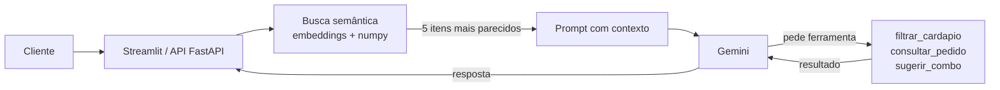

# 🍕 Assistente de Cardápio com IA

Agente de atendimento para restaurante de delivery: responde sobre pratos, ingredientes, alérgenos e preços com base no cardápio, consulta o status de pedidos e monta uma refeição dentro do orçamento do cliente.

Usa **RAG** (busca semântica no cardápio) para não inventar informação e **tool calling** para executar ações com dados exatos.

**[▶ Testar o demo](LINK-DO-DEMO)** · restaurante e dados fictícios

<!-- Grave um GIF de ~15 s usando o app e coloque aqui:  -->

## O que ele faz

| Pergunta do cliente | Como o agente resolve |
|---|---|
| "A pizza de calabresa tem lactose?" | Busca o item no cardápio (RAG) e responde com os alérgenos exatos |
| "Quais pratos são veganos?" | Chama `filtrar_cardapio`, que devolve **todos** os itens que atendem ao filtro |
| "Cadê meu pedido 1006?" | Chama `consultar_pedido` e informa status, previsão e atraso |
| "Tenho R$ 100 para duas pessoas" | Chama `sugerir_combo`, que monta prato, bebida e sobremesa dentro do valor |
| "Vocês têm sushi?" | Diz que não encontrou no cardápio e sugere uma alternativa que existe |

## Como funciona



1. A pergunta vira um embedding e é comparada (similaridade de cosseno) com os embeddings dos 31 itens do cardápio.
2. Os 5 itens mais parecidos entram no prompt como contexto.
3. O modelo responde ou pede uma ferramenta. O código executa a função em Python, devolve o resultado e repete, até 4 rodadas.
4. A interface mostra quais itens foram buscados e quais ferramentas foram chamadas em cada resposta.

## Decisões técnicas

- **RAG + ferramentas, e não só RAG.** A busca semântica traz os 5 itens mais parecidos, o que é ótimo para "o que tem na pizza X?" mas falha em "liste todos os veganos" (são 12). Para listagens, o modelo chama uma ferramenta que filtra os dados de forma exata.
- **Ferramentas determinísticas.** Status de pedido, filtros e cálculo de combo são Python puro. O modelo decide *quando* chamar e *com quais argumentos*; o código garante que o resultado está certo.
- **Loop de tool calling escrito à mão.** A chamada automática do SDK está desligada para registrar cada chamada, limitar as rodadas e transformar argumentos inválidos em erro que o modelo consegue corrigir, sem derrubar a aplicação.
- **Índice vetorial em memória.** Com 31 itens, numpy resolve em microssegundos e não exige nenhum serviço extra. Os embeddings ficam em cache em `data/embeddings.json` e só são refeitos se o cardápio ou o modelo mudar. Para milhares de itens, a troca por ChromaDB ou pgvector fica isolada em `retrieval.py`.
- **Temperatura 0,2 e instruções explícitas** para reduzir respostas inventadas: só responder com o que está no contexto ou nos resultados das ferramentas.

## Avaliação

`scripts/avaliar.py` roda 15 perguntas com resposta conhecida (preços, alérgenos, pedidos existentes, cancelados e inexistentes, perguntas fora do cardápio) e confere o conteúdo da resposta e a ferramenta chamada.

<!-- Depois de rodar, cole o resumo aqui. Exemplo: **14 de 15 corretas**, tempo médio de 1,8 s. Tabela completa em resultados_avaliacao.md -->

Além disso, 19 testes automatizados (`pytest`) cobrem ferramentas, busca, o loop do agente e a API usando dublês, sem chamar a API do Gemini. Eles rodam no GitHub Actions a cada push.

## Como rodar

Pré-requisitos: Python 3.10+ e uma chave gratuita da API do Gemini ([Google AI Studio](https://aistudio.google.com/apikey)).

```bash
git clone https://github.com/MatGIT19/assistente-cardapio-ia.git
cd assistente-cardapio-ia
python -m venv .venv && source .venv/bin/activate   # Windows: .venv\Scripts\activate
pip install -r requirements-dev.txt
cp .env.example .env          # e coloque sua chave em GEMINI_API_KEY

python scripts/construir_indice.py   # gera os embeddings do cardápio
streamlit run streamlit_app.py       # interface de chat
uvicorn api:app --reload             # API REST, documentação em /docs
pytest -q                            # testes
python scripts/avaliar.py            # avaliação com 15 perguntas
```

Com Docker: `docker build -t assistente-cardapio . && docker run -e GEMINI_API_KEY=sua-chave -p 8000:8000 assistente-cardapio`

### Exemplo de chamada da API

```bash
curl -X POST localhost:8000/chat -H "Content-Type: application/json" \
  -d '{"mensagem": "Cadê meu pedido 1006?", "historico": []}'
```

## Estrutura

```
app/
  agent.py       loop do agente: contexto do RAG + tool calling
  retrieval.py   índice vetorial e busca por similaridade
  tools.py       filtrar_cardapio, consultar_pedido, sugerir_combo
  llm.py         cliente Gemini e embeddings
  data.py        leitura do cardápio e dos pedidos
  config.py      variáveis de ambiente
data/            cardápio (31 itens) e pedidos (12) fictícios
scripts/         construir_indice.py, avaliar.py
tests/           pytest com dublês da API
docs/            GIF e prints usados neste README
api.py           FastAPI
streamlit_app.py interface de chat
Dockerfile       imagem da API
.github/         CI que roda os testes a cada push
```

## Licença

MIT. Veja [LICENSE](LICENSE).

## Próximos passos

- Memória de preferências do cliente entre conversas (ex.: "sou vegetariano").
- Trocar o cardápio fictício por dados vindos de uma API real.
- Avaliação com mais perguntas e um segundo modelo como juiz das respostas.

---

Feito por **Matteus Prado** · [LinkedIn](https://www.linkedin.com/in/matteus-prado-31b18a364) · [GitHub](https://github.com/MatGIT19)
